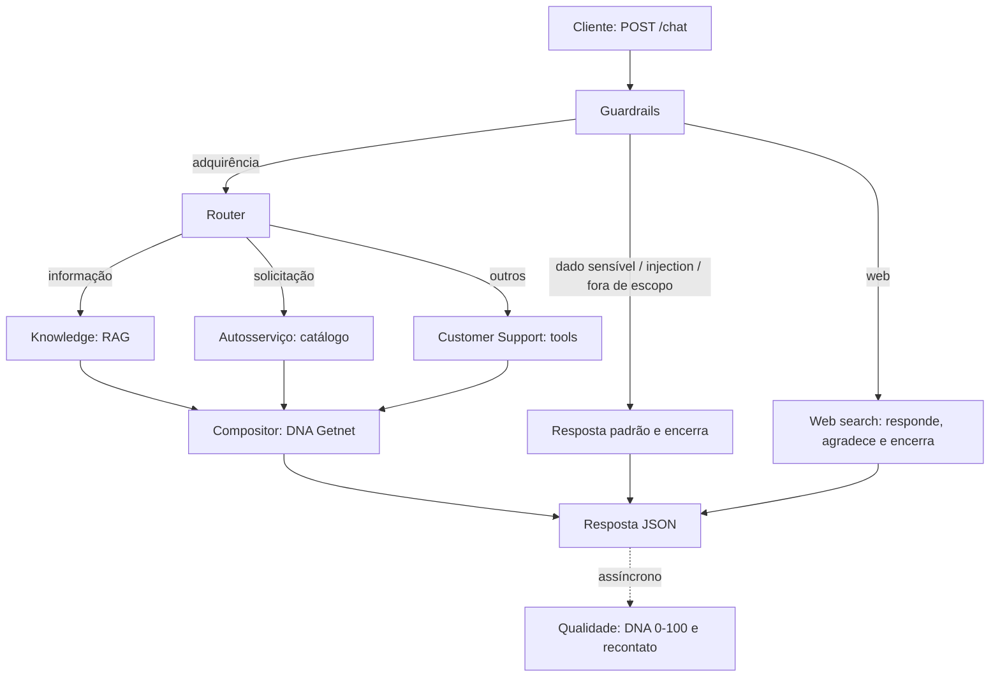

# Getnet Multi-Agent Support System

API conteinerizada que atende clientes Getnet com uma orquestração de agentes de IA. Cada mensagem passa por uma triagem de segurança, é roteada para um ou mais agentes especializados e volta como uma resposta única no **DNA Getnet**: útil, calma, amigável e empoderadora. Depois que a resposta sai, um agente de Qualidade mede a assertividade e a aderência ao DNA, sem atrasar o cliente.

## Sumário

- [Como rodar](#como-rodar)
- [Arquitetura](#arquitetura)
- [Agentes](#agentes)
- [Fluxo de uma mensagem](#fluxo-de-uma-mensagem)
- [Pipeline RAG](#pipeline-rag)
- [Qualidade e observabilidade](#qualidade-e-observabilidade)
- [Segurança](#segurança)
- [Testes](#testes)
- [Decisões de projeto](#decisões-de-projeto)
- [Estrutura do repositório](#estrutura-do-repositório)

## Como rodar

**Pré-requisitos:** Docker e Docker Compose; chave de um provedor de LLM (OpenAI por padrão); opcionalmente, chave da [Tavily](https://tavily.com) para busca na web.

```bash
cp .env.example .env      # preencha OPENAI_API_KEY (e TAVILY_API_KEY, se quiser busca web)
docker compose up --build
```

Na primeira subida, o container cria a base mock e roda a ingestão do RAG (crawl dos dois sites, alguns minutos). Nas próximas, o índice é reaproveitado do volume.

```bash
curl -X POST http://localhost:8000/chat \
  -H "Content-Type: application/json" \
  -d '{"message": "When will the money from yesterday'\''s sales be deposited?", "user_id": "cliente1988"}'
```

| Comando | O que faz |
| --- | --- |
| `docker compose run --rm api pytest` | Testes unitários e de integração (LLM e RAG simulados, sem chave) |
| `docker compose run --rm api python -m tests.eval.run_eval` | Avaliação com LLM real nos cenários do desafio |
| `docker compose run --rm api python -m app.rag.ingest --force` | Recria o índice RAG |
| `docker compose run --rm api python -m app.data.mock_db` | Recria a base mock |

Documentação interativa da API: http://localhost:8000/docs

### Endpoints

`POST /chat`

```json
{ "message": "How does receivables advance (antecipação) work with Getnet?", "user_id": "cliente1988" }
```

```json
{
  "response": "Olá! ...",
  "route": { "triage": "adquirencia", "agents": ["knowledge", "self_service"], "theme": "antecipacao" },
  "sources": ["https://site.getnet.com.br/get-ajuda/...", "https://minhaconta.getnet.com.br/login"],
  "tools_used": ["catalog:antecipacao"],
  "conversation_closed": false,
  "trace_id": "8f3c..."
}
```

- `triage`: `adquirencia`, `web`, `dado_sensivel`, `injection` ou `fora_de_escopo`.
- `conversation_closed`: `true` quando a triagem encerra o atendimento.
- `trace_id`: liga a resposta aos logs e à avaliação de qualidade.

`GET /metrics` devolve o resumo de qualidade (DNA por pilar, taxa de recontato, triagem, latência). `GET /health` atende o healthcheck.

## Arquitetura

A orquestração é um grafo **LangGraph**: cada agente é um nó, e as decisões de triagem e roteamento são arestas condicionais. A Qualidade roda fora do grafo, como tarefa em segundo plano da API.



O Router é um **gateway inclusivo**: pode acionar Knowledge e Autosserviço em paralelo quando a mensagem traz uma dúvida e uma solicitação ("como funciona a antecipação? quero antecipar"). As saídas se acumulam no estado (`outputs`, com reducer de soma de listas) e o Compositor junta tudo em uma mensagem com uma única saudação.

**Comunicação entre agentes:** chamadas diretas via estado compartilhado do grafo (`app/state.py`). Cada agente lê o que precisa do estado e devolve uma atualização parcial; os agentes especializados devolvem `AgentOutput` (conteúdo factual, fontes, tools usadas), sem saudação, e só o Compositor fala com o cliente.

## Agentes

| Agente | Arquivo | Responsabilidade |
| --- | --- | --- |
| Guardrails | `app/agents/guardrails.py` | Triagem em 5 destinos: regex para dados sensíveis e injection, depois classificador LLM de tema |
| Router | `app/agents/router.py` | Classifica a intenção, escolhe uma ou mais rotas e um tema (usado no recontato) |
| Knowledge | `app/agents/knowledge.py` | Query rewriting + RAG sobre getnet.net e Get Ajuda, com fontes citadas |
| Autosserviço | `app/agents/self_service.py` | Identifica a solicitação no catálogo e indica portal Minha Conta ou app |
| Customer Support | `app/agents/support.py` | Planeja e executa 3 tools sobre dados mock da conta + orientações do Get Ajuda |
| Compositor | `app/agents/composer.py` | Junta as saídas e aplica o padrão de atendimento do DNA Getnet |
| Web search | `app/agents/web.py` | Pergunta geral: busca na web, responde com fonte e horário, agradece e encerra |
| Qualidade | `app/agents/quality.py` | LLM-as-judge do DNA (0 a 25 por pilar) + alertas, em segundo plano |

Todos os prompts estão em `app/prompts/__init__.py`, em um só lugar para revisão. Toda saída estruturada é validada com Pydantic.

### Tools do Customer Support

| Tool | Responde | Observação |
| --- | --- | --- |
| `get_settlements` | Quando cai o dinheiro das vendas | Calcula datas pelo plano de recebimento (débito D+1 útil, crédito por ciclo, parcelas) |
| `get_transactions` | Por que a venda foi recusada | Código e motivo da recusa |
| `get_terminal_status` | Por que a máquina não conecta | Modelo, conexão, último sinal |

O LLM só planeja quais tools chamar (`SupportPlan`). O código executa sempre com o `user_id` da requisição, então o modelo nunca escolhe de quem são os dados. A base (`app/data/mock_db.py`) é gerada com datas relativas a hoje, para "as vendas de ontem" sempre existirem, e não contém CPF, CNPJ nem endereço.

### Catálogo de autosserviço

`data/self_service_catalog.json` traz as 13 solicitações (cancelamento de vendas, antecipação, domicílio bancário, chargeback, Pix, endereço, boleto, instalação adicional, manutenção, bobinas, representante legal, Get Tap, extrato eletrônico). O LLM escolhe apenas os ids; o texto e os canais vêm do arquivo. Por isso a resposta é determinística e nunca traz links inventados.

## Fluxo de uma mensagem

Exemplo: *"How does receivables advance (antecipação) work with Getnet?"*

1. **Guardrails:** sem dado sensível nem padrão de injection; o classificador devolve `adquirencia`.
2. **Router:** dúvida ("how does") sobre um item do catálogo → rotas `knowledge` + `self_service`, tema `antecipacao`.
3. **Knowledge** (em paralelo): reescreve a pergunta em até 3 queries, recupera trechos e responde só com base neles, com as URLs.
4. **Autosserviço** (em paralelo): identifica `antecipacao` e devolve o caminho no portal ou no app.
5. **Compositor:** saudação, explicação, próximo passo (onde antecipar) e despedida.
6. **API:** responde ao cliente e grava o atendimento (mensagem já mascarada).
7. **Qualidade** (depois da resposta): nota de DNA e, se o cliente voltar no mesmo tema em 24 horas, este atendimento é marcado como não resolvido.

## Pipeline RAG

**Ingestão** (`app/rag/ingest.py`, roda uma vez na subida):

1. **Crawl** em largura dentro do domínio e do prefixo de cada fonte (`https://www.getnet.net/en/` e `https://site.getnet.com.br/get-ajuda/`), respeitando `robots.txt`, com limite de páginas e pausa entre requisições.
2. **Limpeza** com BeautifulSoup: remove menus, rodapés, scripts e formulários.
3. **Chunking** com `RecursiveCharacterTextSplitter` (800 caracteres, sobreposição de 100, cortes preferindo parágrafos e frases). O título da página entra no início de cada chunk.
4. **Embeddings** com um modelo multilíngue (`text-embedding-3-small` por padrão), porque as fontes misturam inglês e português.
5. **Armazenamento** no Chroma, em volume persistente, com metadados: URL, título, idioma e data da coleta.

**Recuperação** (`app/rag/retriever.py`): busca com a pergunta original e as reescritas, `top_k=4` por query, deduplicação por URL e trecho. Os trechos entram no prompt delimitados (`<trecho url=...>`), como dados e não como instruções. Sem trecho relevante, o agente diz que não encontrou e indica o Get Ajuda.

Todos os parâmetros (chunk, sobreposição, top-k, fontes, limite de páginas) são configuráveis no `.env`.

## Qualidade e observabilidade

O agente de Qualidade **mede e não bloqueia**: roda como `BackgroundTask` do FastAPI depois do envio da resposta, e qualquer falha nele é registrada sem afetar o cliente.

**Assertividade por recontato.** Cada atendimento é gravado com `user_id`, tema e data. Se o mesmo cliente volta no mesmo tema dentro da janela (24 horas, configurável), o atendimento anterior é marcado como não resolvido. O tema vem do Router em rótulos normalizados (`recebimento`, `conexao_maquina`), o que agrupa a mesma dúvida escrita de jeitos diferentes. A métrica é a taxa de resolução sem recontato, geral e por tema.

**DNA Getnet (LLM-as-judge).** Um modelo separado do gerador (`JUDGE_MODEL`) dá de 0 a 25 pontos por pilar, com justificativa:

| Pilar | O que o avaliador verifica |
| --- | --- |
| Útil | Traduziu termos técnicos e simplificou o caminho |
| Calmo | Reduziu incertezas e terminou com o próximo passo explícito |
| Amigável | Frases curtas, tom de conversa, sem jargão |
| Empoderado | Explicou o porquê, deu opções e mostrou onde o cliente age sozinho |

Também marca dois alertas: `sem_fonte` (fato de produto sem fonte quando havia fontes) e `dado_sensivel`, que combina o juiz com a mesma regex dos guardrails.

**Observabilidade.**
- Logs JSON por atendimento (triagem, rotas, tema, confiança do Router, tools, latência, recontato) e por avaliação, ligados pelo `trace_id`.
- SQLite com atendimentos e avaliações; `GET /metrics` agrega score por pilar e por rota, taxa de recontato por tema, distribuição da triagem e latência média.
- `tests/eval/run_eval.py` roda os cenários com LLM real e sai com erro se a acurácia de rota cair abaixo de 100% ou o DNA médio ficar abaixo do mínimo. Serve como teste de regressão para mudanças de prompt e pode ser ligado a um alerta no CI.

## Segurança

- **Dados pessoais:** regex para CPF, CNPJ, CEP, telefone, e-mail e endereço roda antes de qualquer LLM. Encontrado um dado, o atendimento é encerrado com uma explicação e a indicação do portal Minha Conta. O dado é mascarado (`[MASCARADO]`) antes de chegar a qualquer agente, log ou banco.
- **Prompt injection:** padrões conhecidos detectados por regra e, no que escapar, pelo classificador LLM (`is_injection`). O atendimento é encerrado sem revelar instruções.
- **Isolamento de conteúdo:** mensagem do cliente, trechos do RAG, dados das tools e resultados da web entram nos prompts delimitados por tags, com a instrução explícita de que são dados.
- **Tools só de leitura**, sempre filtradas pelo `user_id` da requisição.
- **Segredos** apenas em `.env` (fora do Git); `.env.example` versionado.

## Testes

```bash
docker compose run --rm api pytest      # ou: pip install -r requirements.txt && pytest
```

| Camada | Arquivos | O que cobre |
| --- | --- | --- |
| Unitários | `tests/unit/` | Regex de dados sensíveis e injection; triagem; regras do Router; Knowledge com e sem trechos; catálogo; tools e isolamento por usuário; Compositor; recontato e score de DNA |
| Integração | `tests/integration/` | Os 10 cenários do desafio + 4 casos extras percorrem o grafo completo; contrato HTTP; fallback cordial em falha do LLM; dado sensível nunca gravado |
| Avaliação | `tests/eval/run_eval.py` | LLM real: acurácia de rota, DNA por cenário, detecção de recontato |

Os testes unitários e de integração usam um LLM simulado (`tests/fakes.py`) que decide por palavras-chave. Assim, eles rodam em segundos, sem chave e de forma determinística, e testam a **orquestração** (triagem, rotas, paralelismo, tools, composição, registro). A qualidade das respostas do LLM real é medida pela avaliação.

### Cenários do desafio

| Mensagem | Triagem | Agentes | Tools |
| --- | --- | --- | --- |
| Get Clássica vs Get Smart | adquirência | Knowledge | — |
| Previsão do tempo em Porto Alegre | web | Web search | — |
| Quando cai o dinheiro de ontem | adquirência | Support | `get_settlements` |
| Conta bancária para receber via Pix | adquirência | Knowledge | — |
| Máquina não conecta na internet | adquirência | Support | `get_terminal_status` |
| Como funciona a antecipação | adquirência | Knowledge + Autosserviço | catálogo |
| Cotação do euro hoje | web | Web search | — |
| Erro de transação recusada | adquirência | Support | `get_transactions`, `get_terminal_status` |
| Parcelas no crediário | adquirência | Knowledge | — |
| Vender pelo WhatsApp com Link de Pagamento | adquirência | Knowledge | — |

## Resultados da avaliação

Avaliação com LLM real (`python -m tests.eval.run_eval`), 14 cenários: os 10 do desafio e 4 casos extras.

**Acurácia de rota: 100% · DNA Getnet médio: 88,2 / 100 · Recontato detectado: sim**

| Mensagem | Rota ok | Útil | Calmo | Amigável | Empoderado | Total |
| --- | --- | --- | --- | --- | --- | --- |
| Get Clássica vs Get Smart | sim | 20 | 25 | 25 | 25 | 95 |
| Previsão do tempo em Porto Alegre | sim | 20 | 20 | 25 | 20 | 85 |
| Quando cai o dinheiro de ontem | sim | 20 | 25 | 25 | 20 | 90 |
| Conta bancária para receber via Pix | sim | 25 | 25 | 25 | 25 | 100 |
| Máquina não conecta na internet | sim | 20 | 20 | 25 | 15 | 80 |
| Como funciona a antecipação | sim | 25 | 25 | 25 | 25 | 100 |
| Cotação do euro hoje | sim | 15 | 10 | 20 | 15 | 60 |
| Erro de transação recusada | sim | 20 | 20 | 25 | 20 | 85 |
| Parcelas no crediário | sim | 20 | 20 | 25 | 20 | 85 |
| Vender pelo WhatsApp com Link de Pagamento | sim | 20 | 20 | 25 | 20 | 85 |
| Mensagem com CPF (dado sensível) | sim | 20 | 25 | 25 | 20 | 90 |
| Tentativa de prompt injection | sim | 20 | 25 | 25 | 25 | 95 |
| Pedido fora de escopo | sim | 20 | 25 | 20 | 20 | 85 |
| Pedido de bobinas (autosserviço) | sim | 25 | 25 | 25 | 25 | 100 |

**Leitura dos resultados.** O ponto mais fraco é a busca na web: a nota varia entre execuções conforme os resultados retornados (a cotação do euro já ficou com 80 e com 60). O pilar Empoderado também é o mais baixo no Support, que pode explicar melhor onde o cliente age sozinho. As duas melhorias são os próximos passos naturais dos prompts, e a avaliação serve de regressão para medi-las.

## Decisões de projeto

| Decisão | Alternativa descartada | Motivo |
| --- | --- | --- |
| LangGraph como orquestrador | Cadeia de chamadas manual | Fluxo explícito, rotas condicionais e paralelas nativas |
| Web search acionada na triagem, como tool compartilhada | Web search dentro do Knowledge | Encerra rápido sem passar pelo Router; o Knowledge fica focado na base Getnet |
| Qualidade assíncrona, só mede | Avaliador bloqueando respostas | Sem latência extra para o cliente |
| Assertividade pelo recontato | Nota de "acerto" dada pelo LLM | Mede o resultado real para o cliente |
| Gateway inclusivo no Router | Uma rota por mensagem | Atende dúvida e solicitação juntas |
| Compositor único para o tom | DNA aplicado em cada agente | Evita saudação duplicada e centraliza o padrão |
| Regras antes do LLM nos guardrails | Só classificador LLM | Mais barato, auditável e dado sensível nunca chega ao modelo |
| Catálogo de autosserviço em JSON | Resposta livre do LLM | Determinístico, sem links inventados |
| Protocolo `LLM` com duas operações | Agentes acoplados ao SDK | Provedor trocado por configuração; testes sem chave |
| Avaliador com modelo separado | Mesmo modelo do gerador | Reduz o viés de autoavaliação |

**Limitações conhecidas.** O crawl não executa JavaScript: páginas renderizadas só no navegador ficam de fora (o próximo passo seria um navegador headless). Cada chamada é um atendimento completo, sem memória de conversa. O handoff humano ficou fora do escopo por decisão de produto.

## Estrutura do repositório

```
app/
  main.py               API (FastAPI)
  service.py            caso de uso: executa o grafo, registra, mede latência
  graph.py              orquestração (LangGraph)
  state.py              estado compartilhado e contratos
  llm.py                camada de LLM (provedor configurável)
  config.py             configuração via ambiente
  prompts/              prompts de todos os agentes
  agents/               guardrails, router, knowledge, self_service, support, composer, web, quality
  tools/                tools da conta, catálogo, web search
  rag/                  ingestão e recuperação
  data/mock_db.py       base mock da conta
  observability/        logs JSON, registro de atendimentos, métricas
data/self_service_catalog.json
tests/                  unit, integration, eval, fakes e cenários
docker/entrypoint.sh    prepara base mock e índice na subida
Dockerfile, docker-compose.yml, .env.example
```
