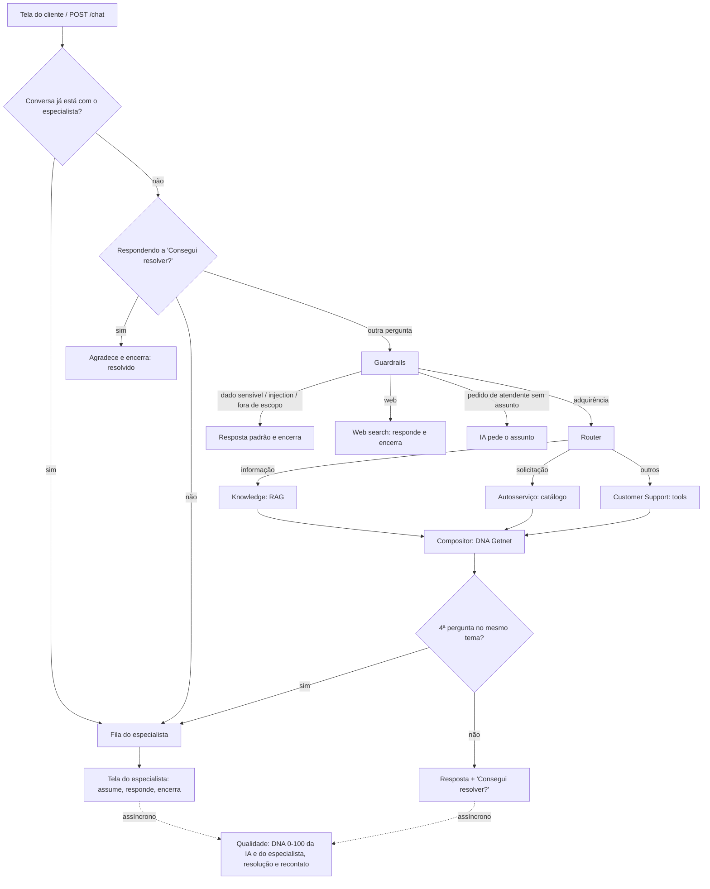

# Getnet Multi-Agent Support System

Atendimento a clientes Getnet com uma orquestração de agentes de IA, um especialista humano para o transbordo e um time de qualidade medindo tudo com a mesma régua: o **DNA Getnet** (útil, calmo, amigável e empoderado).

A solução é uma API conteinerizada com três telas:
- **Cliente:** chat com a IA, que resolve dúvidas de produto, dados da conta e autosserviço e, ao final, pergunta se resolveu.
- **Especialista:** fila de transbordo (quando o cliente diz que não resolveu), histórico e o que a IA já fez.
- **Qualidade:** DNA por pilar da IA e dos especialistas, assertividade por recontato, transbordo e avaliação em lote off-line por CSV.

   **Vídeo de apresentação:** _(link)_ · **Versão publicada:** https://getnet-multiagent.onrender.com (acesso com código; solicite à autora)

## Sumário

- [Como rodar](#como-rodar)
- [As três telas](#as-três-telas)
- [Arquitetura](#arquitetura)
- [Agentes](#agentes)
- [Transbordo para o especialista](#transbordo-para-o-especialista)
- [Pipeline RAG](#pipeline-rag)
- [Qualidade e observabilidade](#qualidade-e-observabilidade)
- [Testes off-line](#testes-off-line)
- [Resultados da avaliação](#resultados-da-avaliação)
- [Publicação no Render](#publicação-no-render)
- [Segurança](#segurança)
- [Decisões de projeto](#decisões-de-projeto)
- [Estrutura do repositório](#estrutura-do-repositório)

## Como rodar

**Pré-requisitos:** Docker e Docker Compose; chave de um provedor de LLM (OpenAI por padrão) e chave da [Tavily](https://tavily.com) para a busca na internet (perguntas atuais como placar, classificação, clima e câmbio).

```bash
cp .env.example .env      # preencha OPENAI_API_KEY e TAVILY_API_KEY
docker compose up --build
```

Abra http://localhost:8000: a página inicial leva às três telas. Na primeira subida, o container cria a base mock e roda a ingestão do RAG (alguns minutos); nas próximas, o índice é reaproveitado do volume.

**Funcionamento real.** Com `OFFLINE_MODE=false` (padrão, e fixo no `render.yaml`), toda resposta vem do LLM, da base de conhecimento e da internet de verdade. `GET /health` mostra o modo e se as três peças estão prontas: `{"status": "ok", "modo": "real", "checks": {"llm": true, "busca_web": true, "base_conhecimento": true}}`. Se aparecer `"incompleto"`, falta uma chave ou o índice.

**Modo simulado, só para testes:** `OFFLINE_MODE=true docker compose up --build` sobe tudo com LLM, RAG e busca simulados, sem chave e sem internet. As respostas são de exemplo e as telas mostram a etiqueta "off-line"; não use esse modo para demonstrar ou avaliar o atendimento.

| Comando | O que faz |
| --- | --- |
| `docker compose run --rm api pytest` | Testes unitários, de integração e HTTP, todos off-line (sem chave e sem rede) |
| `docker compose run --rm api python -m tests.eval.run_eval` | Avaliação com LLM real nos cenários do desafio |
| `docker compose run --rm api python -m app.batch_eval app/web/static/exemplos/replay.csv` | Avaliação em lote de um CSV pela linha de comando |
| `docker compose run --rm api python -m app.batch_eval app/web/static/exemplos/pool_perguntas.csv --sortear 10` | Sorteia 10 perguntas do pool e roda com o sistema real |
| `docker compose run --rm api python -m app.rag.ingest --force` | Recria o índice RAG |

Documentação interativa da API: http://localhost:8000/docs

### Endpoints

`POST /chat` (contrato do desafio, com campos extras opcionais)

```json
{ "message": "How does receivables advance (antecipação) work with Getnet?", "user_id": "cliente1988" }
```

```json
{
  "response": "Olá! ...",
  "route": { "triage": "adquirencia", "agents": ["knowledge", "self_service"], "theme": "antecipacao" },
  "sources": ["https://site.getnet.com.br/duvidas/antecipacao-de-vendas/", "https://minhaconta.getnet.com.br/login"],
  "tools_used": ["catalog:antecipacao"],
  "conversation_closed": false,
  "trace_id": "8f3c...",
  "conversation_id": "a1b2c3...",
  "status": "ia",
  "specialist": null,
  "handoff": false,
  "delivered_to_human": false
}
```

- `triage`: `adquirencia`, `web`, `dado_sensivel`, `injection`, `fora_de_escopo` ou `humano` (pedido de atendente).
- `conversation_id` (opcional na entrada): mantém a conversa; sem ele, cada chamada é um atendimento novo.
- `status`: `ia`, `aguardando_humano`, `em_atendimento` ou `encerrada`.

Outros: `GET /health`, `GET /metrics` (resumo de qualidade) e as APIs das telas em `/api/...` (veja `/docs`). Com `ACCESS_CODE` definido, tudo exceto `/health`, `/api/config` e as páginas exige o cabeçalho `X-Access-Code`.

## As três telas

| Tela | Endereço | O que faz |
| --- | --- | --- |
| Cliente | `/cliente` | Chat com a IA. Toda resposta dos agentes termina com **"Consegui resolver?"** e os botões **Sim** / **Não**. Atalhos com os cenários do desafio e a opção **Bastidores**, que mostra em cada resposta a triagem, os agentes, as tools e as fontes. Depois do transbordo, a resposta do especialista chega na mesma conversa. |
| Especialista | `/especialista` | Fila de transbordo (aguardando, comigo, com outros), histórico completo, motivo do transbordo, o que a IA já fez, sugestão da IA (no transbordo por tentativas), lembrete do DNA e a **nota de DNA de cada resposta enviada**, alguns segundos depois. |
| Qualidade | `/qualidade` | Indicadores (atendimentos, **resolvido pela IA confirmado pelo cliente**, resolução sem recontato, DNA da IA e dos especialistas, taxa de transbordo), DNA por pilar IA x especialistas, ranking de especialistas com o pilar a desenvolver, assertividade por tema, avaliações com justificativa e **avaliação em lote por CSV**. |

As telas são HTML e JavaScript sem build, servidos pela própria API (`app/web/static`). Os textos vindos do servidor são sempre inseridos como texto, nunca como HTML.

## Arquitetura



A orquestração dos agentes é um grafo **LangGraph** (`app/graph.py`): cada agente é um nó e as decisões de triagem e roteamento são arestas condicionais. O Router é um **gateway inclusivo**: pode acionar Knowledge e Autosserviço em paralelo. As saídas se acumulam no estado e o Compositor junta tudo em uma mensagem com uma única saudação.

Em volta do grafo, `app/service.py` cuida da conversa: abre ou recupera a conversa, decide o transbordo e registra mensagens e atendimentos. A Qualidade roda em segundo plano depois da resposta, sem atrasar o cliente.

## Agentes

| Agente | Arquivo | Responsabilidade |
| --- | --- | --- |
| Guardrails | `app/agents/guardrails.py` | Triagem em 6 destinos: regex para dados sensíveis, injection e pedido de atendente; depois classificador LLM de tema |
| Router | `app/agents/router.py` | Classifica a intenção, escolhe uma ou mais rotas e um tema (usado no recontato e no transbordo) |
| Knowledge | `app/agents/knowledge.py` | Query rewriting + RAG sobre getnet.net e Get Ajuda, com fontes citadas |
| Autosserviço | `app/agents/self_service.py` | Identifica a solicitação no catálogo e indica portal Minha Conta ou app |
| Customer Support | `app/agents/support.py` | Planeja e executa 3 tools sobre dados mock da conta + orientações do Get Ajuda |
| Compositor | `app/agents/composer.py` | Junta as saídas e aplica o padrão de atendimento do DNA Getnet |
| Web search | `app/agents/web.py` | Pergunta atual ou geral (placar, classificação, notícias, clima, câmbio, fatos): prepara a busca com a data de hoje, busca na internet, responde com fonte e data, agradece e encerra |
| Qualidade | `app/agents/quality.py` | LLM-as-judge do DNA (0 a 25 por pilar) + alertas, para respostas da IA **e dos especialistas** |

Todos os prompts estão em `app/prompts/__init__.py`. Toda saída estruturada é validada com Pydantic.

### Perguntas atuais (busca na internet)

Perguntas como "qual o placar do último jogo do Corinthians?" ou "como está a classificação do Brasileirão?" dependem do dia em que são feitas. O agente de busca:

1. **Prepara a busca com a data de hoje** (horário de Brasília): o LLM reescreve a pergunta com nomes completos e mês e ano ("Corinthians resultado último jogo placar novembro 2026") e escolhe o tipo: notícias (jogos, placares, classificação, notícias) ou geral (clima, câmbio, fatos).
2. **Busca na Tavily** em profundidade avançada, com janela de tempo para assuntos recentes (última semana) e o conteúdo das 3 páginas mais relevantes, para que tabelas de classificação e placares completos cheguem ao LLM. Se a janela não trouxer nada, repete sem a janela.
3. **Ordena do mais recente para o mais antigo** e passa ao LLM a data de publicação de cada resultado.
4. **Responde** com o resultado mais recente, sem misturar datas: no placar, os dois times, o placar, a competição e a data; na classificação, a rodada e as primeiras posições com os pontos (e a posição do time citado). Sempre cita a fonte. Se os resultados não mostrarem a informação mais recente, diz isso e indica onde conferir.

Palpites e opiniões ("qual time vai ganhar?") são fora de escopo. A busca na internet nunca transfere para o especialista.

### Tools do Customer Support

| Tool | Responde | Observação |
| --- | --- | --- |
| `get_settlements` | Quando cai o dinheiro das vendas | Calcula datas pelo plano de recebimento (débito D+1 útil, crédito por ciclo, parcelas) |
| `get_transactions` | Por que a venda foi recusada | Código e motivo da recusa |
| `get_terminal_status` | Por que a máquina não conecta | Modelo, conexão, último sinal |

O LLM só planeja quais tools chamar, em campos fixos. O código executa sempre com o `user_id` da requisição, então o modelo nunca escolhe de quem são os dados. A base (`app/data/mock_db.py`) é gerada com datas relativas a hoje e não contém CPF, CNPJ nem endereço.

### Catálogo de autosserviço

`data/self_service_catalog.json` traz as 13 solicitações (cancelamento de vendas, antecipação, domicílio bancário, chargeback, Pix, endereço, boleto, instalação adicional, manutenção, bobinas, representante legal, Get Tap, extrato eletrônico). O LLM escolhe só os ids; texto e canais vêm do arquivo, então nunca há links inventados.

## Transbordo para o especialista

**A IA sempre tenta resolver primeiro.** O especialista humano entra só depois que o atendimento passou pelos agentes.

1. **Toda resposta dos agentes** (Knowledge, Autosserviço, Support) termina com "Consegui resolver o seu pedido?". Na tela, aparecem os botões Sim e Não; por texto, frases como "sim", "obrigado", "não resolveu" e "ainda não" também valem.
   - **Sim:** a IA agradece e encerra a conversa. A resolução fica registrada como confirmada pelo cliente.
   - **Não:** a conversa vai para a fila do especialista, com todo o histórico.
   - **Outra pergunta:** segue com a IA, que responde e pergunta de novo.
2. **Tentativas no mesmo tema:** se o cliente segue perguntando sobre o mesmo assunto, a IA continua tentando. Na **4ª pergunta** sobre o mesmo tema na conversa (configurável em `HANDOFF_AFTER_ATTEMPTS`), a conversa vai para o especialista, e a resposta que a IA daria vira sugestão para ele. Perguntas sobre outros temas não contam.
3. **Pedido de atendente logo de início:** a IA pede o assunto e tenta resolver. Se o pedido já vem com o assunto ("quero falar com um atendente sobre minha venda recusada"), segue direto para os agentes.
4. **Nunca vão para o especialista:** a busca web (placares, classificação, notícias, clima, câmbio) e os bloqueios (dado sensível, injection, fora de escopo), que encerram o atendimento.

Depois do transbordo, as mensagens do cliente vão só para o especialista, sem passar pela IA. O especialista assume a conversa (só uma pessoa por vez), responde e encerra. Depois do encerramento, uma nova mensagem abre outra conversa, de volta com a IA.

Cada resposta do especialista é avaliada no DNA Getnet com a mesma régua da IA. A nota aparece para ele na própria mesa e para a qualidade no ranking de especialistas.

## Pipeline RAG

**Ingestão** (`app/rag/ingest.py`):

1. **Crawl** em largura dentro do domínio e do prefixo de cada fonte: Get Ajuda, as FAQs em `/duvidas/`, as páginas de produto (maquininhas, Pix, crediário, Link de Pagamento, Get Tap, conta digital, taxas) e `getnet.net/en`. Respeita `robots.txt`, ignora blog e carreiras, normaliza URLs e faz uma pausa entre requisições.
2. **Limpeza** com BeautifulSoup: remove menus, rodapés, scripts e formulários.
3. **Chunking** com `RecursiveCharacterTextSplitter` (800 caracteres, sobreposição de 100). O título da página vai no início de cada chunk.
4. **Embeddings** multilíngues (`text-embedding-3-small`), porque as fontes misturam inglês e português.
5. **Armazenamento** no Chroma, com URL, título, idioma e data da coleta.

**Recuperação** (`app/rag/retriever.py`): MMR (relevância + diversidade) com a pergunta original e as reescritas, no máximo 2 trechos por página e 10 no total, para que uma página não ocupe todo o contexto em perguntas que comparam produtos. Os trechos entram no prompt delimitados, como dados.

Na ingestão atual, a base tem 78 páginas e 632 chunks.

## Qualidade e observabilidade

**Resolução confirmada pelo cliente.** Cada "sim" ou "não" à pergunta "Consegui resolver?" fica registrado na resposta da IA a que se refere. A tela mostra a taxa de resolução pela IA e quantas perguntas foram respondidas.

**Assertividade por recontato.** Se o mesmo cliente volta ao mesmo tema em até 24 horas (configurável), o atendimento anterior é marcado como não resolvido. A métrica é a taxa de resolução sem recontato, geral e por tema. Ela complementa a resolução confirmada, porque nem todo cliente responde à pergunta.

**DNA Getnet (LLM-as-judge).** Um modelo separado do gerador (`JUDGE_MODEL`) dá de 0 a 25 pontos por pilar, com justificativa, e marca alertas de resposta sem fonte e de dado sensível. A mesma régua vale para a IA e para os especialistas, o que permite comparar os dois na tela da qualidade.

| Pilar | O que o avaliador verifica |
| --- | --- |
| Útil | Traduziu termos técnicos e simplificou o caminho |
| Calmo | Reduziu incertezas e terminou com o próximo passo explícito |
| Amigável | Frases curtas, tom de conversa, sem jargão |
| Empoderado | Explicou o porquê, deu opções e mostrou onde o cliente age sozinho |

**Avaliação em lote.** Pela tela da qualidade (upload de CSV) ou pela CLI `python -m app.batch_eval arquivo.csv`, em dois modos detectados pelas colunas:

| Modo | Colunas | Para que serve |
| --- | --- | --- |
| Replay | `mensagem` (+ opcionais `cliente`, `triagem_esperada`, `agentes_esperados`) | Cada mensagem passa pelo sistema inteiro; mede DNA e acurácia de rota. Regressão de prompts. |
| Respostas já dadas | `mensagem`, `resposta` (+ opcional `especialista`) | Só o avaliador de DNA roda. Avalia atendimentos humanos já realizados (por exemplo, transcrições), sem depender do sistema no ar. |

Exemplos em `app/web/static/exemplos/`. Os lotes não entram nas métricas da operação nem na fila do especialista.

**Perguntas aleatórias.** O arquivo `exemplos/pool_perguntas.csv` tem 60 perguntas com a rota esperada: produtos, conta, autosserviço, perguntas atuais (placares, classificação, próximos jogos, Fórmula 1, câmbio, clima, Selic, notícias), fatos gerais, fora de escopo, segurança e pedido de atendente. Use de três jeitos:

- **Tela do cliente:** o botão **Sortear pergunta** coloca uma pergunta do pool no campo de mensagem (sem repetir até esgotar).
- **Tela da qualidade:** **Sortear e rodar** escolhe N perguntas e roda o replay, com DNA e acurácia de rota.
- **Linha de comando:** `python -m app.batch_eval app/web/static/exemplos/pool_perguntas.csv --sortear 10`.

**Observabilidade.** Logs JSON por atendimento (triagem, rotas, tema, confiança do Router, tools, latência, recontato, transbordo) e por avaliação, ligados por `trace_id` e `conversation_id`. SQLite com conversas, mensagens, atendimentos, avaliações e lotes; `GET /metrics` agrega tudo.

## Testes off-line

Todos os testes automatizados rodam **sem chave e sem internet**: usam um LLM, um RAG e uma busca web simulados (`app/offline.py`), que decidem por palavras-chave. Um teste específico bloqueia qualquer conexão de rede e percorre a jornada inteira; ele falha se algum componente tentar sair para a internet.

```bash
docker compose run --rm api pytest
```

| Camada | Arquivos | O que cobre |
| --- | --- | --- |
| Unitários | `tests/unit/` | Guardrails (dados sensíveis, injection, pedido de atendente), Router, Knowledge, catálogo, tools, Compositor, recontato, DNA, **resolução e transbordo** (sim, não, nova pergunta, 4ª tentativa, busca web nunca transfere), **lote**, **regras dos endpoints** (código de acesso, limite de uso, fila, especialista), migração do banco e a **jornada sem rede** |
| Integração | `tests/integration/` | Os 10 cenários do desafio + 5 casos extras pelo grafo completo; HTTP: telas, código de acesso, transbordo e especialista, lote |
| Avaliação | `tests/eval/run_eval.py` | LLM real: acurácia de rota, DNA por cenário, detecção de recontato |

O mesmo modo simulado sobe a aplicação inteira com `OFFLINE_MODE=true`, para demonstrar as telas sem custo.

### Cenários do desafio

| Mensagem | Triagem | Agentes | Tools |
| --- | --- | --- | --- |
| Get Clássica vs Get Smart | adquirência | Knowledge | — |
| Previsão do tempo em Porto Alegre | web | Web search | — |
| Quando cai o dinheiro de ontem | adquirência | Support | `get_settlements` |
| Conta bancária para receber via Pix | adquirência | Knowledge | — |
| Máquina não conecta na internet | adquirência | Support | `get_terminal_status` |
| Como funciona a antecipação | adquirência | Knowledge + Autosserviço | catálogo |
| Cotação do euro hoje | web | Web search | — |
| Erro de transação recusada | adquirência | Support | `get_transactions` |
| Parcelas no crediário | adquirência | Knowledge | — |
| Vender pelo WhatsApp com Link de Pagamento | adquirência | Knowledge | — |

## Resultados da avaliação

Avaliação com LLM real (`python -m tests.eval.run_eval`), 14 cenários: os 10 do desafio e 4 casos extras.

**Acurácia de rota: 100% · DNA Getnet médio: 88,2 / 100 · Recontato detectado: sim**

| Mensagem | Rota ok | Útil | Calmo | Amigável | Empoderado | Total |
| --- | --- | --- | --- | --- | --- | --- |
| Get Clássica vs Get Smart | sim | 20 | 25 | 25 | 25 | 95 |
| Previsão do tempo em Porto Alegre | sim | 20 | 20 | 25 | 20 | 85 |
| Quando cai o dinheiro de ontem | sim | 20 | 25 | 25 | 20 | 90 |
| Conta bancária para receber via Pix | sim | 25 | 25 | 25 | 25 | 100 |
| Máquina não conecta na internet | sim | 20 | 20 | 25 | 15 | 80 |
| Como funciona a antecipação | sim | 25 | 25 | 25 | 25 | 100 |
| Cotação do euro hoje | sim | 15 | 10 | 20 | 15 | 60 |
| Erro de transação recusada | sim | 20 | 20 | 25 | 20 | 85 |
| Parcelas no crediário | sim | 20 | 20 | 25 | 20 | 85 |
| Vender pelo WhatsApp com Link de Pagamento | sim | 20 | 20 | 25 | 20 | 85 |
| Mensagem com CPF (dado sensível) | sim | 20 | 25 | 25 | 20 | 90 |
| Tentativa de prompt injection | sim | 20 | 25 | 25 | 25 | 95 |
| Pedido fora de escopo | sim | 20 | 25 | 20 | 20 | 85 |
| Pedido de bobinas (autosserviço) | sim | 25 | 25 | 25 | 25 | 100 |

**Leitura dos resultados.** O ponto mais fraco é a busca na web: a nota varia entre execuções conforme os resultados retornados (a cotação do euro já ficou com 80 e com 60). O pilar Empoderado é o mais baixo no Support, que pode explicar melhor onde o cliente age sozinho. As duas melhorias são os próximos passos naturais dos prompts, e a avaliação serve de regressão para medi-las.

## Publicação no Render

O repositório traz um `render.yaml` (Blueprint) que cria o serviço a partir do `Dockerfile`.

1. **Versione o índice RAG** (o plano gratuito do Render não tem disco persistente; com o índice no repositório, o serviço sobe em segundos e sem refazer o crawl):

   ```bash
   docker compose run --rm -v "$PWD/data:/out" api sh -c "rm -rf /out/index && cp -r /app/var/chroma /out/index"
   ```

   Faça commit e push da pasta `data/index`.
2. No [Render](https://render.com), entre com o GitHub e clique em **New + → Blueprint**. Escolha este repositório.
3. Preencha `OPENAI_API_KEY`, `TAVILY_API_KEY` e `ACCESS_CODE` (o código que as telas e a API vão pedir) e clique em **Apply**.
4. Ao fim do deploy, o endereço fica em `https://getnet-multiagent-xxxx.onrender.com`.

Pontos do plano gratuito: o serviço "dorme" após 15 minutos sem acesso e leva cerca de 1 minuto para acordar; conversas e avaliações ficam em SQLite local e são zeradas quando o serviço reinicia. Em produção, o próximo passo seria um banco gerenciado (Postgres). O uso é protegido por código de acesso, limite por minuto e teto diário de mensagens.

## Segurança

- **Dados pessoais:** regex para CPF, CNPJ, CEP, telefone, e-mail e endereço roda antes de qualquer LLM e mascara o dado (`[MASCARADO]`) antes de chegar a agentes, logs, banco ou tela do especialista. A mesma máscara vale para o que o especialista escreve.
- **Prompt injection:** padrões conhecidos detectados por regra e, no que escapar, pelo classificador LLM.
- **Isolamento de conteúdo:** mensagem, trechos do RAG, dados das tools e resultados da web entram nos prompts delimitados, como dados.
- **Tools só de leitura**, sempre filtradas pelo `user_id` da requisição; o cliente só lê as conversas do próprio `user_id`.
- **Publicação:** código de acesso (comparação em tempo constante), limite por IP por minuto e teto diário global, para proteger os créditos do LLM.
- **Segredos** apenas em `.env` ou no painel do Render, nunca no repositório.

## Decisões de projeto

| Decisão | Alternativa descartada | Motivo |
| --- | --- | --- |
| LangGraph como orquestrador | Cadeia de chamadas manual | Fluxo explícito, rotas condicionais e paralelas nativas |
| Especialista só depois da IA: "não resolveu" do cliente ou 4ª tentativa no mesmo tema | Transferir no primeiro pedido de atendente ou por baixa confiança do LLM | A IA resolve o que consegue; o especialista recebe só o que de fato precisa de uma pessoa, com o histórico completo |
| Pergunta "Consegui resolver?" em toda resposta dos agentes | Inferir a resolução só pelo recontato | Dá a resolução confirmada pelo próprio cliente e o gatilho claro do transbordo |
| Sugestão da IA entregue ao especialista (transbordo por tentativas) | Especialista começa do zero | Reduz o tempo de resposta e mantém a consistência da informação |
| Mesma régua de DNA para IA e especialistas | Avaliar só a IA | Permite comparar canais e orientar o desenvolvimento de cada especialista |
| Lote em dois modos (replay e respostas já dadas) | Só replay | O modo de respostas avalia atendimentos humanos sem depender do sistema |
| Telas em HTML/JS servidas pela API | Front-end separado (React) | Um único deploy, sem build, fácil de rodar e publicar |
| Regras de endpoint independentes do framework | Lógica dentro das rotas FastAPI | Testáveis sem servidor; as rotas só fazem a ligação |
| Modo off-line com simulados | Testes que dependem de chave e rede | Testes rápidos, determinísticos e sem custo; demonstração sem internet |
| Web search acionada na triagem | Web search dentro do Knowledge | Encerra rápido sem passar pelo Router |
| Qualidade assíncrona, só mede | Avaliador bloqueando respostas | Sem latência extra para o cliente |
| Assertividade pelo recontato | Nota de "acerto" dada pelo LLM | Mede o resultado real para o cliente |
| Regras antes do LLM nos guardrails | Só classificador LLM | Mais barato, auditável, e dado sensível nunca chega ao modelo |
| Avaliador com modelo separado | Mesmo modelo do gerador | Reduz o viés de autoavaliação |

**Limitações conhecidas.** O crawl não executa JavaScript: parte do conteúdo do site fica de fora. A IA não tem memória entre mensagens da mesma conversa (cada mensagem é respondida isoladamente; a conversa serve ao transbordo e ao especialista). No Render gratuito, os dados são zerados a cada reinício.

## Estrutura do repositório

```
app/
  main.py               API (FastAPI): /chat, /metrics, /health, telas e /api/...
  service.py            conversa, grafo, transbordo e registro
  graph.py              orquestração dos agentes (LangGraph)
  batch_eval.py         avaliação em lote por CSV (tela e CLI)
  offline.py            LLM, RAG e busca web simulados (testes e OFFLINE_MODE)
  state.py, llm.py, config.py
  prompts/              prompts de todos os agentes
  agents/               guardrails, router, knowledge, self_service, support, composer, web, quality
  tools/                tools da conta, catálogo, web search
  rag/                  ingestão e recuperação
  data/mock_db.py       base mock da conta
  observability/        logs JSON, conversas, avaliações, lotes e métricas
  web/handlers.py       regras dos endpoints (acesso, limites, especialista, qualidade)
  web/static/           telas: index, cliente, especialista, qualidade (+ exemplos de CSV)
data/self_service_catalog.json
data/index/             índice RAG versionado para a publicação
tests/                  unit, integration, eval
docker/start.sh         prepara base mock e índice e sobe a API
Dockerfile, docker-compose.yml, render.yaml, .env.example
```
